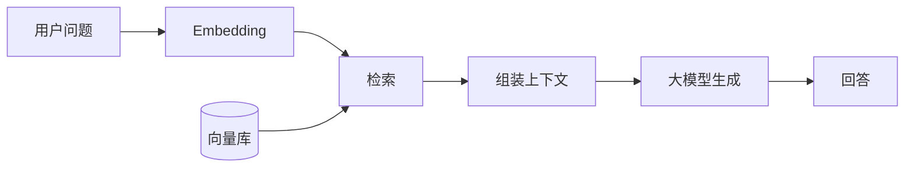
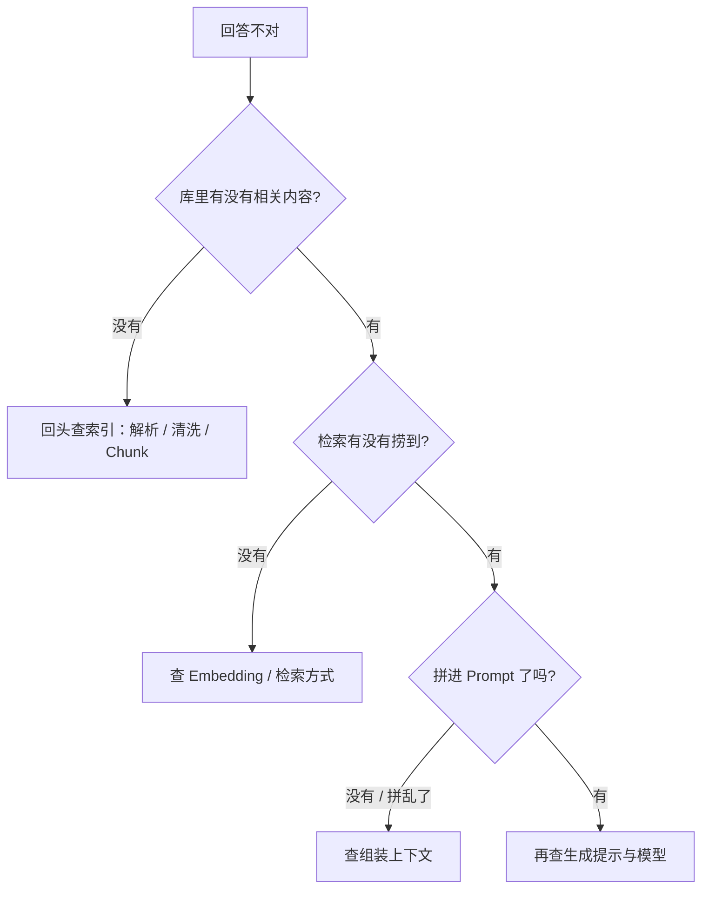
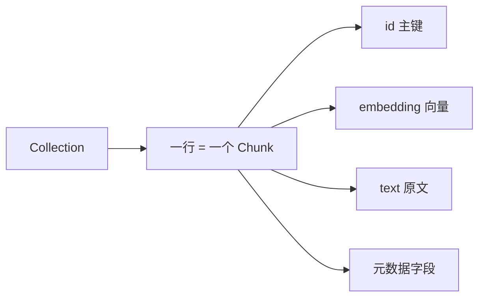
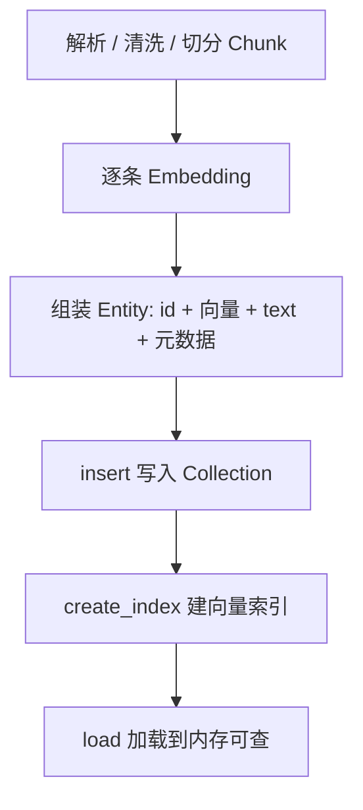
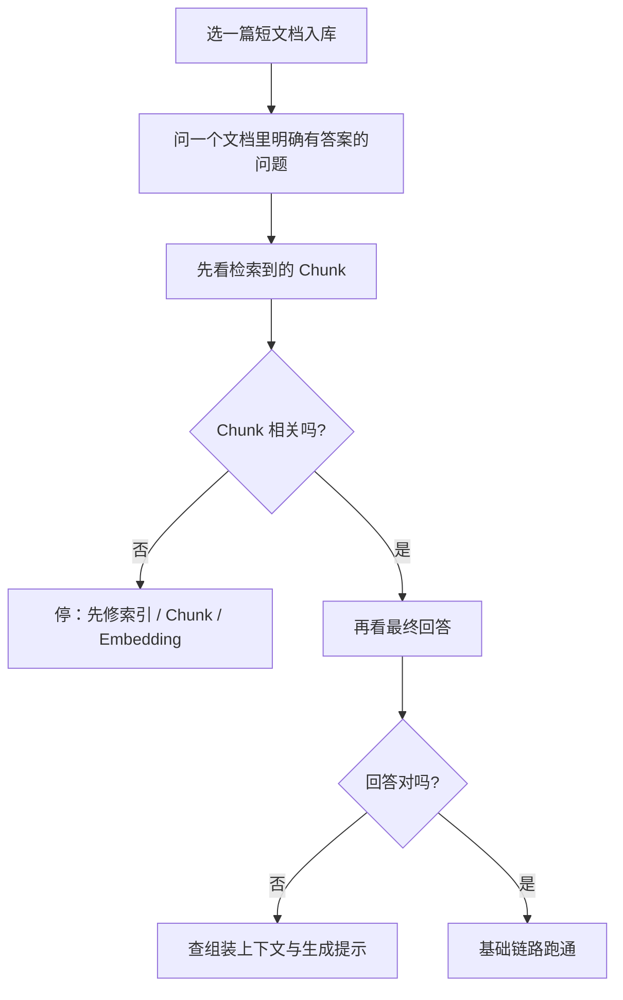
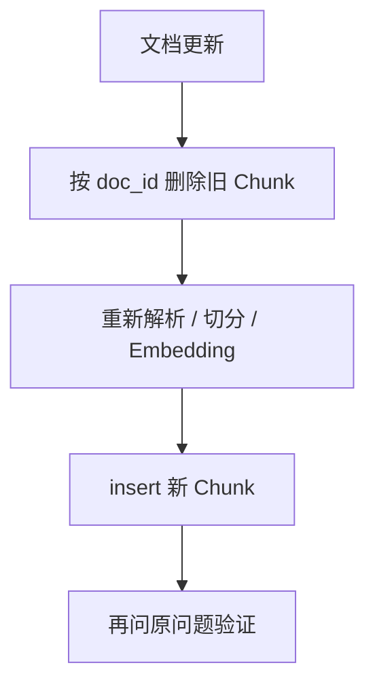
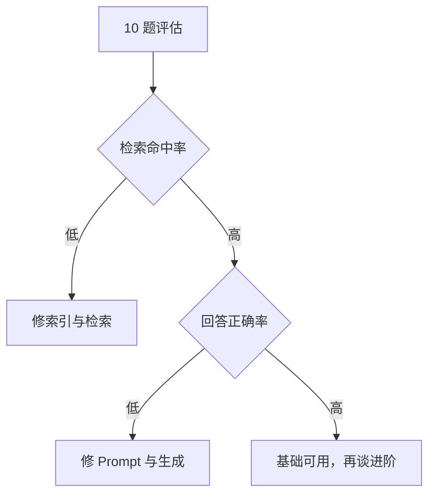
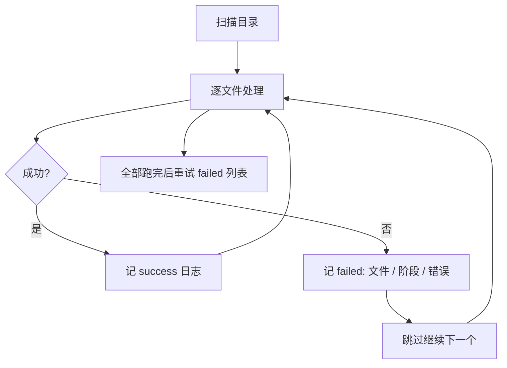

两条基础链路：离线把知识存进去，在线按问题取出来再回答。

## 1. 索引构建（离线）


## 2. 检索生成（在线）



## 名词解释

| 名词 | 解释 |
|------|------|
| 解析 | 把 PDF / Word 等变成可用文本 |
| 清洗 | 去噪、去页眉页脚 / 乱码，统一格式 |
| 上传 | 把处理好的内容送入后续流水线 |
| 安全围栏 | 鉴权、脱敏、拦截敏感 / 违规内容 |
| 拆分 Chunk | 把长文切成小段，便于检索 |
| 挂元数据 | 附上来源、标题、时间、权限等标签 |
| Embedding | 把文本变成向量（数字表示语义） |
| 向量库 | 存向量，按相似度查找 |
| 检索 | 用问题向量在库里找相关 Chunk |
| 组装上下文 | 把检索到的 Chunk 和问题拼成 Prompt |
| 生成 | 把上下文交给大模型写出回答 |

## 可选补充（非最基础）

- 检索前后也可加安全围栏（拦敏感问 / 敏感答）
- 改写、重排等属于进阶优化，未画入上图

---

## 下一步该补什么

链路知道之后，优先补 **「效果差时查哪」**。  
多数问题出在这三处，先会排查，再谈进阶优化。



### 1. Chunk 怎么切（影响最大）

| 要点 | 基础做法 |
|------|----------|
| 长度 | 太短丢上下文，太长难命中；先从数百到一千字左右试 |
| 重叠 | 相邻 Chunk 留一点重叠，避免句子被拦腰切断 |
| 边界 | 尽量按标题、段落切，少按固定字数硬切 |

### 2. 检索有没有捞对

| 要点 | 基础做法 |
|------|----------|
| Top-K | 先取前几条相关 Chunk，太少易漏、太多易吵 |
| 看原文 | 答错时先打开捞到的 Chunk，确认是不是相关段落 |
| 元数据 | 能按来源 / 权限过滤时先过滤，减少噪声 |

### 3. 上下文怎么拼

| 要点 | 基础做法 |
|------|----------|
| 顺序 | 通常：系统说明 → 检索片段 → 用户问题 |
| 引用 | 片段带来源，方便核对与追溯 |
| 长度 | 塞太多会稀释重点；只留检索到的相关段 |

---

## Embedding：入库和查询必须同一套

| 要点 | 说明 |
|------|------|
| 同一模型 | 入库用的 Embedding 模型 = 提问时用的模型 |
| 同一维度 | 向量长度必须一致，否则无法进同一库检索 |
| 换模型要重做 | 换 Embedding 模型后，旧向量失效，需要重新 Embedding 再入库 |

一句话：**问题向量和文档向量，要在同一个「语义坐标系」里。**

---

## 向量库里存什么（以 Milvus 为准）

Milvus 里一张表叫 **Collection**。  
一条 Chunk 对应一行 Entity，至少包含：**主键 + 向量 + 文本 + 元数据**。



### 基础 Schema（建议字段）

| 字段 | Milvus 类型 | 说明 |
|------|-------------|------|
| `id` | INT64 / VARCHAR（主键） | 唯一标识这一条 Chunk |
| `embedding` | FLOAT_VECTOR(dim) | Embedding 向量；`dim` 与模型一致 |
| `text` | VARCHAR | Chunk 原文，检索后拼 Prompt 用 |
| `doc_id` | VARCHAR | 来源文档 ID |
| `title` | VARCHAR | 文档 / 章节标题 |
| `source` | VARCHAR | 来源路径或业务来源 |
| `chunk_index` | INT64 | 在文档中的第几段 |

只存向量、不存 `text` → 捞到了也拼不出上下文。  
`dim` 必须与 Embedding 模型一致；换模型要重建 Collection 或全量重写向量。

### 怎么存（入库流程）



### 伪代码：建库 + 入库

```text
# 1. 连接
client = Milvus.connect(host, port)

# 2. 建 Collection（dim 与 Embedding 模型一致，例如 1024）
schema = {
  id:        INT64, primary_key=True
  embedding: FLOAT_VECTOR, dim=1024
  text:      VARCHAR(65535)
  doc_id:    VARCHAR(64)
  title:     VARCHAR(256)
  source:    VARCHAR(512)
  chunk_index: INT64
}
client.create_collection("rag_chunks", schema)

# 3. 文档 → Chunk → 向量 → 写入
chunks = split_into_chunks(clean(parse(document)))
entities = []
for i, chunk in enumerate(chunks):
    vec = embedding_model.encode(chunk.text)   # 同一套 Embedding
    entities.append({
        id:          new_id(),
        embedding:   vec,
        text:        chunk.text,
        doc_id:      document.id,
        title:       document.title,
        source:      document.source,
        chunk_index: i
    })

client.insert("rag_chunks", entities)

# 4. 建索引并加载（基础用 IVF_FLAT 或 HNSW 即可）
client.create_index("rag_chunks", field="embedding", index_type="HNSW", metric="COSINE")
client.load_collection("rag_chunks")
```

### 伪代码：检索

```text
# 用户问题 → 同一套 Embedding → 向量检索 → 拿回 text + 元数据
q_vec = embedding_model.encode(user_question)

results = client.search(
    collection = "rag_chunks",
    data       = [q_vec],
    anns_field = "embedding",
    limit      = top_k,                    # 例如 5
    output_fields = ["text", "doc_id", "title", "source", "chunk_index"],
    # 可选：按元数据过滤
    # filter = 'source == "手册A"'
)

# results 里每条含：score + text + 元数据
context = join_texts(results)              # 组装上下文
answer  = llm.generate(prompt=system + context + user_question)
```

### 和前面链路的对应关系

| 链路步骤 | 落在 Milvus 的动作 |
|----------|-------------------|
| Embedding 后入库 | `insert` 写入 `embedding` + `text` + 元数据 |
| 检索 | `search` 用问题向量查，返回 `text` 等字段 |
| 挂元数据 / 过滤 | Schema 里的标量字段 + `filter` |
| 文档更新 | 先按 `doc_id` 删旧 Chunk，再重新 insert |

---

## 最小联调（先跑通再优化）

用 **一篇文档 + 一个问题** 验证整条链路：



检查顺序（很重要）：

1. **先看检索结果**，再看回答  
2. 检索不对 → 别先怪大模型  
3. 检索对、回答错 → 再查 Prompt 组装与生成

### 联调时记录三件事

| 记录 | 用途 |
|------|------|
| 入库了哪些 Chunk | 确认内容是否进库、切分是否合理 |
| Top-K 命中了哪几条 | 确认检索是否捞对 |
| 最终 Prompt 长什么样 | 确认模型「看见」了什么 |

---

---

## 解析常见坑（索引源头）

库里没有好内容，后面全白做。基础阶段先盯这三类：

| 坑 | 现象 | 基础处理 |
|----|------|----------|
| PDF 表格 | 行列打散、数字错位 | 表格尽量结构化提取；提取后人工抽查几页 |
| 扫描件 | 几乎无字 / 乱码 | 先 OCR，再清洗；识别差的页先别入库 |
| 乱码与噪声 | 页眉页脚、水印、重复目录 | 清洗规则去掉；入库前抽几条 Chunk 肉眼看 |

抽查口诀：**解析完先打开文本看一眼，再 Embedding。**

---

## 相似度在说什么

Milvus 检索返回的 `score`，含义取决于 **metric**（建索引时选定，查询必须一致）。

| metric | 分数怎么粗看 | 基础选用 |
|--------|--------------|----------|
| COSINE | 越接近 **1** 越相似（常见） | 文本语义检索优先用这个 |
| IP（内积） | 越大越相似 | 向量已归一化时可近似余弦 |
| L2（欧氏距离） | **越小**越相似 | 注意方向和 COSINE 相反 |

基础注意：

1. 建索引的 metric = 查询的 metric，不要混用  
2. 不同模型、不同 metric 的分数 **不能横比绝对数值**  
3. 联调时先看 **排序是否合理**，别死磕「0.82 算不算高」

```text
# 伪代码：看 Top-K 是否相关（比纠结分数更重要）
results = search(q_vec, limit=5, metric="COSINE")
for hit in results:
    print(hit.score, hit.text[:80])   # 先读原文，再谈分数
```

---

## 更新与删除（文档改了怎么办）

文档一变，旧 Chunk 必须换掉，否则会检索到过期内容。



### 伪代码

```text
# 更新一篇文档 = 先删后写
doc_id = document.id

client.delete(
    collection = "rag_chunks",
    filter     = 'doc_id == "{doc_id}"'
)

chunks = split_into_chunks(clean(parse(document)))
entities = []
for i, chunk in enumerate(chunks):
    entities.append({
        id:          new_id(),
        embedding:   embedding_model.encode(chunk.text),
        text:        chunk.text,
        doc_id:      doc_id,
        title:       document.title,
        source:      document.source,
        chunk_index: i
    })

client.insert("rag_chunks", entities)

# 删除整篇
# client.delete("rag_chunks", filter='doc_id == "{doc_id}"')
```

基础约定：

- 用 `doc_id` 关联「一篇文档 → 多条 Chunk」  
- 更新不要只 insert 不 delete（会重复命中）  
- 删完再写入后，用原问题做一次最小联调

---

## 索引选型基础（Milvus）

向量多了不能每次暴力扫全表，需要 **向量索引**。基础先会这两种：

| 索引 | 直觉 | 什么时候用 |
|------|------|------------|
| HNSW | 图索引，召回好、内存占用更高 | 中小规模、要效果时优先 |
| IVF_FLAT | 先分桶再在桶内找，省一点、要调 `nlist` | 数据更大、可接受调参时 |

基础流程仍是：`insert` → `create_index` → `load` → `search`。

```text
# 伪代码：基础用 HNSW + COSINE
client.create_index(
    collection = "rag_chunks",
    field      = "embedding",
    index_type = "HNSW",
    metric     = "COSINE",
    params     = { M: 16, efConstruction: 200 }   # 先用默认/常用值
)
client.load_collection("rag_chunks")

# 查询时可设 ef（搜索宽度）；越大越准、越慢 —— 基础阶段先固定一个值
search_params = { ef: 64 }
```

先记住：

1. **没 load 就不能稳定 search**  
2. metric 选 COSINE 即可起步  
3. 调参是后话；先保证 Schema、同一 Embedding、Top-K 原文正确

---

## 再往后

基础已经覆盖：链路 → 排查 → Embedding → Milvus 存取 → 解析坑 → 相似度 → 更新删除 → 索引入门。

---

## 组装 Prompt 模板

检索对了，还要把内容 **规矩地塞给模型**。基础模板就三段：

```text
[系统说明]
你是助手。只根据「参考资料」回答问题。
若资料不足，明确说「根据现有资料无法确定」，不要编造。
回答时如有依据，可标注来源（如 [1]）。

[参考资料]
[1] title=... | source=... | doc_id=...
{chunk_text_1}

[2] title=... | source=... | doc_id=...
{chunk_text_2}

[用户问题]
{user_question}
```

### 伪代码

```text
hits = milvus.search(q_vec, limit=top_k, output_fields=["text","title","source","doc_id"])

refs = []
for i, hit in enumerate(hits, start=1):
    refs.append(
        f"[{i}] title={hit.title} | source={hit.source} | doc_id={hit.doc_id}\n"
        f"{hit.text}"
    )

prompt = SYSTEM + "\n\n参考资料\n" + "\n\n".join(refs) + "\n\n用户问题\n" + question
answer = llm.generate(prompt)
```

基础约定：

| 约定 | 原因 |
|------|------|
| 先资料、后问题 | 让模型带着依据再读问题 |
| 带来源字段 | 方便核对、追溯 |
| 写清「不足则不编」 | 降低幻觉 |
| 不要塞无关长文 | 噪声会压过关键句 |

---

## Top-K 与上下文长度怎么取舍

| 旋钮 | 太小 | 太大 | 基础起点 |
|------|------|------|----------|
| Top-K | 易漏相关段 | 噪声多、冲淡重点 | 先试 **3～5** |
| 单条 Chunk | 缺上下文 | 一条里杂质多 | 与切分策略一起调 |
| 总上下文 | 信息不够 | 超窗或模型「看不过来」 | 控制在模型窗口舒适区，宁缺毋滥 |

取舍口诀：

1. **先保证 Top-1～Top-3 相关**，再考虑加大 K  
2. K 加大后回答变差 → 多半是噪声，不是「资料不够」  
3. 超长时优先 **丢掉低分命中**，而不是截断每一条的开头

```text
# 伪代码：简单截断策略（基础版）
hits = search(..., limit=10)              # 先多取一点
hits = [h for h in hits if h.score >= min_score]   # 可选：粗过滤
hits = hits[:5]                           # 再截到 Top-K

prompt = build_prompt(hits, question)
if token_len(prompt) > max_ctx:
    hits = hits[:-1]                      # 从分低的开始丢
    prompt = build_prompt(hits, question)
```

---

## 最小评估（10 个问题就够起步）

> 指标拆分、验收习惯、开源框架（Ragas / DeepEval / TruLens 等）见 **[评测](/ai-eng/rag/04-evaluation/)**。

不要一上来上复杂指标。先准备 **10 个问题**，手填一张表：

| 问题 | 期望依据（哪篇/哪段） | 检索是否命中 | 回答是否正确 | 备注 |
|------|----------------------|--------------|--------------|------|
| Q1 | doc_a / 第 2 段 | 是 / 否 | 是 / 否 | |
| … | | | | |

两个基础率：

```text
检索命中率 = 命中相关 Chunk 的问题数 / 10
回答正确率 = 回答正确的问题数 / 10
```

怎么出题（基础）：

1. **事实题**：答案在文档里写得很明确  
2. **跨段题**：答案要拼两段（测 Chunk / Top-K）  
3. **库外题**：文档没有的内容（测会不会瞎编）

解读：

| 现象 | 先修哪里 |
|------|----------|
| 检索命中率低 | 解析 / Chunk / Embedding / 检索 |
| 检索高、回答低 | Prompt 模板 / 上下文组装 / 生成说明 |
| 库外题也硬答 | 系统说明里的「不足则不编」 |



### 伪代码：跑一轮最小评估

```text
cases = load_json("eval_10.json")   # 每条: question, expect_doc_id, expect_keywords
hit, correct = 0, 0

for case in cases:
    hits = search(embed(case.question), limit=5)
    retrieved_docs = [h.doc_id for h in hits]
    if case.expect_doc_id in retrieved_docs:
        hit += 1

    answer = llm.generate(build_prompt(hits, case.question))
    if all(k in answer for k in case.expect_keywords):   # 极简判定
        correct += 1

print("检索命中率", hit / len(cases))
print("回答正确率", correct / len(cases))
```

---

---

## 权限过滤（检索时收窄可见范围）

不是所有人都能看所有文档。基础做法：入库时写上权限标签，查询时用 Milvus `filter` 卡住。

### Schema 再加字段

| 字段 | 类型 | 说明 |
|------|------|------|
| `acl` | VARCHAR | 权限标签，如 `public` / `hr` / `finance` |
| 或 `dept` | VARCHAR | 部门；按你们现有组织模型选一种即可 |

### 伪代码

```text
# 入库时带上 acl
entity.acl = document.acl    # 例如 "hr"

# 查询时：向量检索 + 标量过滤（同时生效）
allowed = user.acl_list      # 例如 ["public", "hr"]

# Milvus 布尔表达式示例：acl in ["public", "hr"]
filter_expr = 'acl in ["' + '", "'.join(allowed) + '"]'

results = client.search(
    collection    = "rag_chunks",
    data          = [q_vec],
    anns_field    = "embedding",
    limit         = top_k,
    filter        = filter_expr,
    output_fields = ["text", "doc_id", "title", "source", "acl"]
)
```

基础约定：

1. **过滤在检索时做**，不要先搜全库再在应用层丢（易漏、也不安全）  
2. 用户无权限的文档，连 Top-K 候选都不应出现  
3. `acl` 变更 = 按 `doc_id` 更新元数据或删了重写

---

## 批量入库与失败重试

大目录不要「一口气全塞」；按文件推进，失败记下来，可重跑。



### 伪代码

```text
files = list_files("./docs")
failed = []

for path in files:
    try:
        doc = parse(path)
        doc = clean(doc)
        doc = security_gate(doc)          # 不过围栏则跳过并记日志
        chunks = split_into_chunks(doc)

        entities = []
        for i, chunk in enumerate(chunks):
            entities.append({
                id: new_id(),
                embedding: embedding_model.encode(chunk.text),
                text: chunk.text,
                doc_id: doc.id,
                title: doc.title,
                source: path,
                chunk_index: i,
                acl: doc.acl
            })

        # 先删旧再写，避免重复
        client.delete("rag_chunks", filter=f'doc_id == "{doc.id}"')
        client.insert("rag_chunks", entities)

        log_success(path, chunk_count=len(entities))

    except Exception as e:
        log_failed(path, stage=current_stage, error=str(e))
        failed.append(path)
        continue

# 第二轮：只重试失败文件（可限次数）
for path in failed:
    retry(path, max_times=3)
```

日志最少记这些：

| 字段 | 用途 |
|------|------|
| `path` / `doc_id` | 定位哪篇 |
| `stage` | 死在解析、Embedding 还是 insert |
| `error` | 原因 |
| `time` | 何时失败 |

---

## 观察字段（每次问答留痕）

线上出问题，没有记录就只能猜。基础请求日志建议固定几项：

| 字段 | 说明 |
|------|------|
| `request_id` | 一次问答的唯一 ID |
| `user_id` | 谁在问（配合权限复盘） |
| `question` | 原问题 |
| `top_k` | 用了多大 K |
| `hit_doc_ids` | 命中了哪些 `doc_id` |
| `hit_scores` | 对应分数（可选） |
| `refused` | 是否因资料不足拒答 |
| `answer` | 最终回答（注意脱敏） |
| `latency_ms` | 总耗时（可选拆检索/生成） |

### 伪代码

```text
request_id = new_id()
hits = search(...)
answer = llm.generate(build_prompt(hits, question))
refused = is_refuse(answer)    # 例如包含「无法确定」或你们的拒答标记

log_event({
    request_id: request_id,
    user_id: user.id,
    question: question,
    top_k: top_k,
    hit_doc_ids: [h.doc_id for h in hits],
    hit_scores: [h.score for h in hits],
    refused: refused,
    answer: mask_sensitive(answer),
    latency_ms: elapsed_ms
})
```

怎么用这些字段：

| 复盘问题 | 看什么 |
|----------|--------|
| 是不是检索错了 | `hit_doc_ids` + 原文档 |
| 是不是乱编 | `refused=false` 但资料其实不够 |
| 是不是权限漏了 | `hit_doc_ids` 是否出现不该看的来源 |
| 是不是变慢 | `latency_ms` 趋势 |

---

## 基础篇收束

到这里，基础工程闭环可以记成：

```text
索引构建（含 Milvus 存取）
  → 检索生成（含 Prompt / Top-K）
  → 权限过滤
  → 批量入库与失败重试
  → 请求观察字段
  → 10 题评估回流
```

### 下一篇

基础稳了之后，看 **[常用增强](/ai-eng/rag/02-enhancements/)**：  
混合检索、Rerank、查询改写、引用角标、Parent-Child、上下文压缩与验收。
