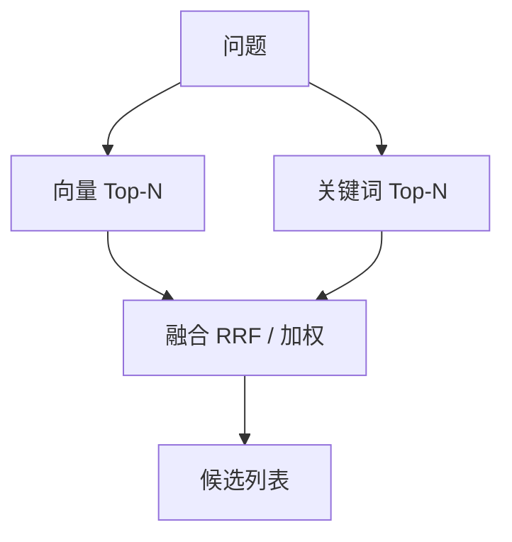
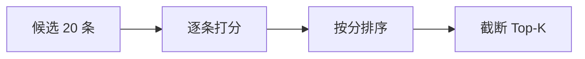
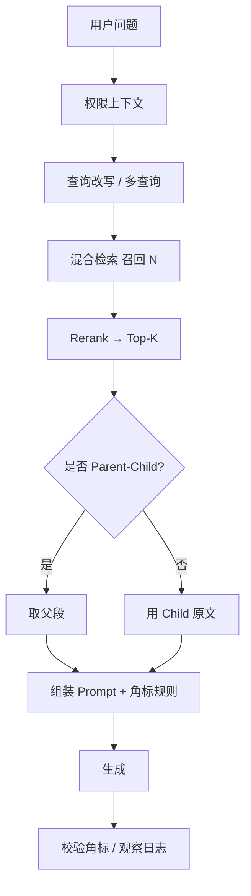

前置：先跑通 [基础链路](/ai-eng/rag/01-basics/)。  
本文只写 **常用、性价比高** 的增强，不展开 GraphRAG / Agent 编排等进阶专题。

增强总览（按上手顺序）：


---

## 1. 混合检索（向量 + 关键词）

### 为什么要

| 场景 | 纯向量 | 加关键词更稳 |
|------|--------|--------------|
| 专有名词、工单号、报错码 | 易漂 | BM25 / 关键词更准 |
| 语义相近但用词不同 | 强 | 可互补 |
| 短查询、口语 | 一般 | 改写后再混检更好 |

### 基础做法

1. **向量检索**：Milvus 语义召回一批  
2. **关键词检索**：BM25 / 全文（可用 Milvus 稀疏向量，或 ES / OpenSearch）  
3. **融合**：把两路结果合成一份候选列表  



### 融合：RRF（常用、好用）

 Reciprocal Rank Fusion：按排名融合，不依赖分数量纲。

```text
# 伪代码：RRF 融合
# score = Σ 1 / (k + rank)   常见 k=60

def rrf_fuse(rank_lists, k=60):
    scores = {}
    for rank_list in rank_lists:          # 每个 list: [id, id, ...]
        for rank, doc_id in enumerate(rank_list, start=1):
            scores[doc_id] = scores.get(doc_id, 0) + 1.0 / (k + rank)
    return sorted(scores.items(), key=lambda x: x[1], reverse=True)
```

### 伪代码：混合检索

```text
q_vec = embed(question)

dense_hits = milvus.search(
    data=[q_vec], limit=20,
    anns_field="embedding",
    filter=acl_filter,
    output_fields=["text","doc_id","title","source"]
)

# 关键词一路：可用稀疏向量 / 外部 BM25
sparse_hits = keyword_search(question, limit=20, filter=acl_filter)

fused_ids = rrf_fuse([
    [h.id for h in dense_hits],
    [h.id for h in sparse_hits],
])

candidates = load_entities_by_ids(fused_ids[:20])   # 供 Rerank 或直接截 Top-K
```

### 基础注意

- 两路都要带上 **同一套权限 filter**  
- 先召回多一点（如 20），再重排或截断  
- 融合后仍要抽查原文，别只看融合分  

---

## 2. 重排序 Rerank

### 为什么要

召回追求「别漏」；重排追求「把最相关的顶上去」。

```text
召回 Top-20（粗排，求全） → Rerank → 保留 Top-3/5（精排，求准）
```

### 基础做法

用 **Cross-Encoder / 专用 Rerank 模型**（或兼容的排序 API）：输入 `(问题, 某条 Chunk)`，输出相关分。



### 伪代码

```text
candidates = hybrid_retrieve(question, limit=20)

scored = []
for c in candidates:
    score = reranker.score(question, c.text)   # 交叉编码打分
    scored.append((score, c))

scored.sort(key=lambda x: x[0], reverse=True)
top = [c for _, c in scored[:5]]

prompt = build_prompt(top, question)
answer = llm.generate(prompt)
```

### 基础注意

| 点 | 说明 |
|----|------|
| 先多召回再重排 | 召回太少，重排救不回来 |
| 控制候选数 | 20～50 常见；过大又贵又慢 |
| 仍要看原文 | 重排分高 ≠ 事实正确 |
| 与评估结合 | 看「检索命中率」是否因重排上升 |

---

## 3. 查询改写

### 为什么要

用户问题常短、口语、缺实体；直接 Embedding 效果不稳。

| 原问题 | 改写方向 |
|--------|----------|
| 「那个报销怎么填」 | 补全业务名：差旅报销单填写规范 |
| 「报错 500」 | 带上系统名 / 模块名（若上下文有） |
| 指代「它 / 上面那个」 | 用对话历史解引用后再检索 |

### 基础做法（两种）

**A. LLM 改写（常用）**

```text
# 伪代码
rewrite_prompt = """
将用户问题改写成适合检索的简洁问句。
保留专有名词与编号；不要编造文档中不存在的实体。
只输出改写后的问题。
用户问题：{question}
"""
query = llm.generate(rewrite_prompt)
hits = retrieve(query)
```

**B. 多查询（Multi-Query）**

一次生成 2～3 个不同表述，分别检索再融合。

```text
queries = llm.generate_multi_queries(question, n=3)
rank_lists = [retrieve_ids(q, limit=10) for q in queries]
fused = rrf_fuse(rank_lists)
```

### 可选：HyDE（先写假答案再检索）

适合语义空泛的问题；成本更高，算常用增强里的「进阶一点」。

```text
fake_answer = llm.generate("根据常识写一段可能的答案：" + question)
hits = retrieve(embed(fake_answer))   # 用答案向量去找文档
```

### 基础注意

- 改写 **不能引入库外实体**（否则检索被带偏）  
- 有对话历史时，先做 **指代消解**，再检索  
- 改写后的 query 写进观察日志，方便复盘  

---

## 4. 引用角标与原文对齐

### 为什么要

回答能溯源，才敢给业务用；也方便评估「是不是瞎编」。

### 基础做法

1. Prompt 里资料带 `[1][2]…` 编号（见基础篇模板）  
2. 要求模型在句子后打角标  
3. 前端把角标链到对应 Chunk / 原文高亮  

```text
# 伪代码：生成后做一次弱校验
answer = llm.generate(prompt_with_refs)

used = extract_citation_ids(answer)          # 如出现的 [1][3]
valid = set(range(1, len(refs)+1))
if used - valid:
    # 出现了不存在的角标 → 降级：去掉非法角标或重试生成
    answer = strip_invalid_citations(answer, valid)
```

### 前端对齐（基础）

| 能力 | 做法 |
|------|------|
| 角标点击 | 打开对应 `doc_id` + `chunk_index` 原文 |
| 高亮 | 用 Chunk 文本在原文中定位（精确匹配或模糊） |
| 无依据回答 | `refused=true` 或无角标时提示「未引用资料」 |


### 基础注意

- 角标必须来自 **本轮真实召回列表**，禁止模型自造编号  
- 一段话多依据时，允许多个角标  
- 评估时可加：**有引用的正确回答占比**  

---

## 5. 小段检索、大段生成（Parent-Child）

### 为什么要

切太碎：检索准，但生成缺上下文。  
切太大：上下文全，但难命中。

### 基础做法

- **Child**：小 Chunk，用于 Embedding / 检索  
- **Parent**：更大段落或整节，用于送进 Prompt  

```text
# 入库
parent = { id: P1, text: 大段 }
child  = { id: C1, text: 小段, parent_id: P1, embedding: embed(小段) }

# 检索
hit_children = search(q_vec, limit=5)
parents = unique([load_parent(c.parent_id) for c in hit_children])
prompt = build_prompt(parents, question)   # 用父段生成
```

---

## 6. 上下文压缩（可选）

Top-K 仍太长、或噪声多时，在进模型前压缩。

| 做法 | 说明 |
|------|------|
| 丢掉低分命中 | 最简单，优先用 |
| LLM 摘要每条 Chunk | 贵；只保留与问题相关句 |
| 抽取式压缩 | 用小模型抽关键句 |

```text
# 伪代码：极简压缩
kept = []
for h in hits:
    snippet = llm.generate(f"只抽取与问题相关的原句，不要改写。\n问题:{q}\n段落:{h.text}")
    if snippet.strip():
        kept.append(h.copy(text=snippet))
prompt = build_prompt(kept, q)
```

基础建议：**先调 Top-K 和 Rerank，再考虑压缩。**

---

## 7. 增强后的推荐链路（拼在一起）



### 伪代码：端到端（增强版）

```text
def answer(user, question):
    acl_filter = build_acl_filter(user)

    query = rewrite(question)                       # 或 multi_query + RRF
    candidates = hybrid_retrieve(query, limit=20, filter=acl_filter)
    top = rerank(query, candidates, keep=5)
    passages = expand_to_parents(top)               # 可选
    prompt = build_prompt_with_citations(passages, question)

    raw = llm.generate(prompt)
    final = validate_citations(raw, passages)

    log_event(...)
    return final
```

---

## 8. 增强项怎么验收

在基础 10 题上扩到 **20～50 题**，对比「关闭增强 / 打开增强」：

| 指标 | 看什么 |
|------|--------|
| 检索命中率 | 混检、改写、Rerank 是否抬升 |
| 回答正确率 | 最终是否更好 |
| 引用合规率 | 角标是否都指向真实资料 |
| 延迟与成本 | Rerank / 多查询是否可接受 |

一次只开一个增强做对比，避免说不清是谁带来的收益。

```text
# 伪代码：开关对比
for mode in ["baseline", "hybrid", "hybrid+rerank", "full"]:
    metrics = eval_set(dataset, mode=mode)
    print(mode, metrics)
```

---

## 9. 什么时候上哪一个

| 现象 | 优先增强 |
|------|----------|
| 专有名词 / 编号搜不准 | 混合检索 |
| 能召回但排序差、答非所问 | Rerank |
| 问题太短、口语、多轮指代 | 查询改写 / 多查询 |
| 业务要溯源、不信任黑盒 | 引用角标 + 高亮 |
| 命中碎、生成缺上下文 | Parent-Child |
| 上下文太长、噪声大 | 先 Rerank，再压缩 |

---

## 10. 常用增强收束

记住一条主链：

```text
改写 → 混合召回 → Rerank →（可选父段）→ 带角标生成 → 校验与日志
```

### 下一篇

基础与常用增强都稳了之后，看 **[进阶](/ai-eng/rag/03-advanced/)**：  
GraphRAG、Agentic RAG、反馈闭环、分项评测、多模态、微调决策与查询路由。
