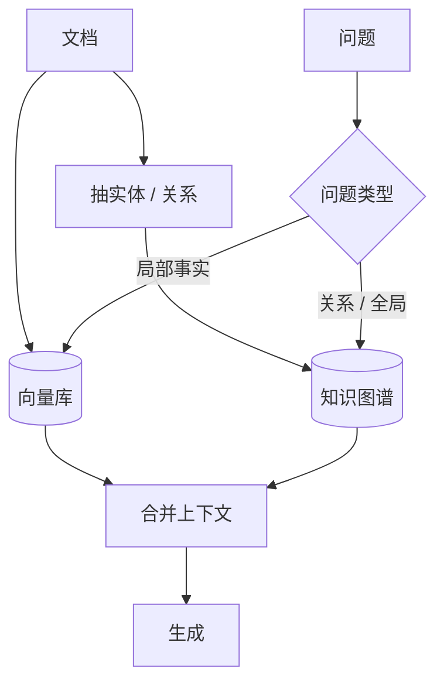
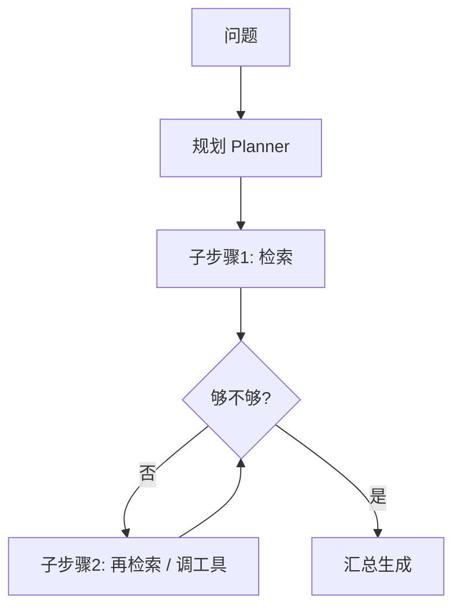
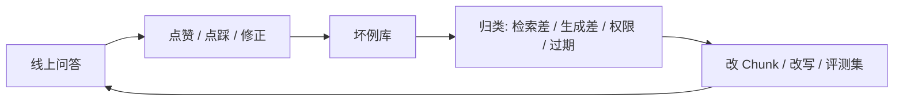
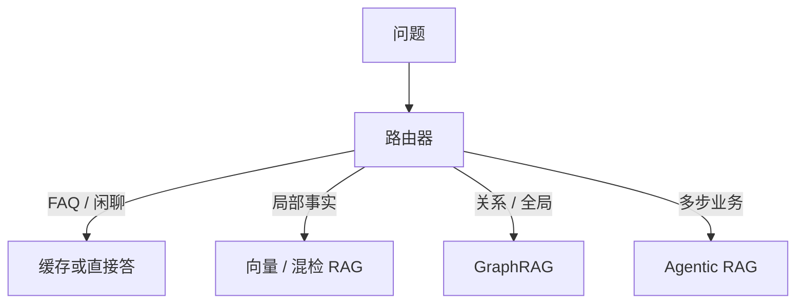
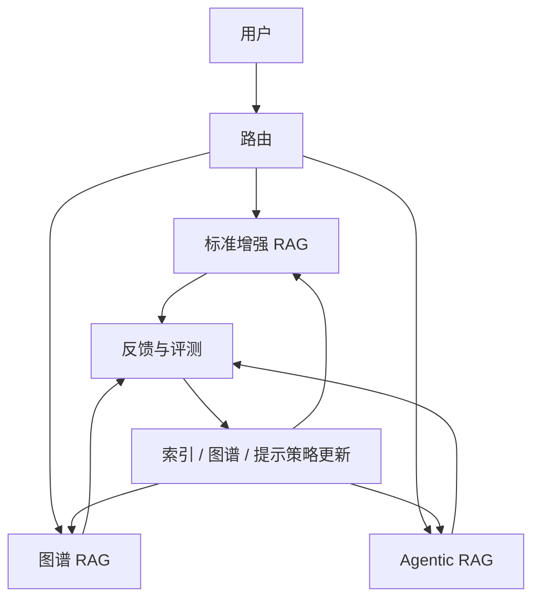

前置：
- [基础链路](/ai-eng/rag/01-basics/)
- [常用增强](/ai-eng/rag/02-enhancements/)

本文写 **常用增强之后** 才值得上的能力：结构化知识、多步智能体、反馈闭环、评测加深、多模态与微调方向。  
仍给伪代码与决策表，不写成某一家框架的操作手册。

---

## 0. 什么时候该进阶

| 信号 | 更可能需要 |
|------|------------|
| 问题要「跨多篇推理 / 归纳全局」 | GraphRAG / 图谱 |
| 单次检索答不好，要拆步骤、查库、用工具 | Agentic RAG |
| 垂类术语多、通用 Embedding 老漂 | 微调 Embedding 或术语库 |
| 图、表、扫描件是主资料 | 多模态 RAG |
| 要持续变好，而不是一次性调参 | 反馈闭环 + 更深评测 |

原则：**先证明基础链路与常用增强的天花板，再开进阶。**

---

## 1. GraphRAG / 知识图谱检索

### 要解决什么

纯向量检索擅长「局部相似段落」；弱于：

- 全局归纳（「本季度所有风险点有哪些」）
- 多跳关系（A 依赖 B，B 影响 C）
- 实体一致性（同一术语多种写法）

### 基础形态（简化）



### 常见两路

| 路线 | 做法 | 成本 |
|------|------|------|
| 轻量图谱 | 规则 / LLM 抽三元组，图数据库或边表存储 | 中 |
| GraphRAG 社区摘要 | 建图 → 社区聚类 → 预生成摘要，查询时先摘要后细节 | 高 |

### 伪代码：轻量「向量 + 图谱」

```text
# 离线：抽三元组入库
for chunk in chunks:
    triples = llm.extract_triples(chunk.text)   # (头实体, 关系, 尾实体)
    graph.upsert(triples, ref=chunk.id)
    milvus.insert(embed(chunk), chunk)

# 在线
ents = llm.extract_entities(question)
graph_hits = graph.expand(ents, hops=1)        # 邻接实体与关系文本
vec_hits   = milvus.search(embed(question), limit=5)

context = render_graph(graph_hits) + render_chunks(vec_hits)
answer  = llm.generate(build_prompt(context, question))
```

### 注意

- 抽错实体会污染全图，要抽查与术语表  
- 不是所有业务都需要图；关系型问题占比低时性价比差  
- 图谱边要带 `chunk_id` / `doc_id`，才能溯源  

---

## 2. Agentic RAG（多步检索与工具）

### 要解决什么

一次「改写 → 检索 → 生成」不够时：需要拆子问题、补查、调用业务 API。



### 最小 Agent 环

```text
state = { question, notes: [], hits: [] }

for step in range(max_steps):   # 例如 3
    plan = llm.plan(state)      # 下一步: retrieve / tool / finish
    if plan.action == "finish":
        break
    if plan.action == "retrieve":
        state.hits += retrieve(plan.query)
        state.notes.append(summarize(state.hits))
    if plan.action == "tool":
        state.notes.append(call_tool(plan.tool, plan.args))

answer = llm.generate(final_prompt(state))
```

### 工具边界（基础安全）

| 规则 | 说明 |
|------|------|
| 白名单工具 | 禁止任意代码执行 |
| 权限透传 | 检索 / API 带用户 acl |
| 步数上限 | 防死循环与费用爆炸 |
| 全程留痕 | 每步 action、query、耗时入观察日志 |

### 何时上

- 复杂对比、多条件排查、需要「先查政策再查工单」  
- 不适合：简单 FAQ（Agent 只会更慢更贵）  

---

## 3. 反馈闭环（让系统持续变好）

### 闭环长什么样



### 最小字段

| 字段 | 用途 |
|------|------|
| `request_id` | 关联观察日志 |
| `feedback` | up / down |
| `reason_tag` | wrong_retrieve / hallucination / outdated / other |
| `correct_doc_id` | 用户或运营标的正确依据（可选） |

### 伪代码

```text
def on_feedback(request_id, feedback, reason_tag=None, correct_doc_id=None):
    row = load_log(request_id)
    save_badcase({
        **row,
        feedback,
        reason_tag,
        correct_doc_id
    })

# 每周：从坏例生成评测题，回归跑一遍
eval_set = badcases_to_eval(load_badcases(days=7))
run_eval(eval_set)
```

### 归类后怎么动

| 标签 | 动作 |
|------|------|
| wrong_retrieve | 查切分、混检、改写、Rerank |
| hallucination | 收紧 Prompt、强制引用、不足则拒答 |
| outdated | 按 `doc_id` 更新删除重写 |
| permission | 查 acl filter |

---

## 4. 更深一层评测

> 完整「如何验证 + 开源框架（Ragas / DeepEval / TruLens 等）」见 **[评测](/ai-eng/rag/04-evaluation/)**。

基础篇有「命中率 / 正确率」。进阶把问题拆开测：

| 维度 | 问题 | 粗算办法 |
|------|------|----------|
| 检索召回 | 该找的段在不在 Top-K | 标注 `golden_chunk_id` |
| 检索精度 | Top-K 里噪声多不多 | 相关条数 / K |
| 忠实度 | 回答是否越出资料 | 人工或 LLM-as-judge |
| 完整性 | 要点是否答全 | 要点清单打勾 |
| 引用质量 | 角标是否指对 | 角标 → chunk 是否支持该句 |

### 伪代码：分项

```text
for case in eval_set:
    hits = pipeline.retrieve(case.q)
    ans  = pipeline.generate(case.q, hits)

    recall = case.golden_id in [h.id for h in hits[:case.k]]
    faithful = judge_faithful(ans, hits)      # 人工或模型
    cite_ok = judge_citations(ans, hits)

    record(recall, faithful, cite_ok)
```

建议：

- 评测集按业务类型分层（事实 / 多跳 / 库外拒答）  
- 每次只改一个模块再对比  
- LLM 评判要抽检，防止「评委模型」自己飘  

---

## 5. 多模态 RAG（基础版）

### 典型输入

- 扫描 PDF、截图、流程图  
- 表格式年报、PPT  

### 两条实用路线

| 路线 | 做法 | 适用 |
|------|------|------|
| 转文本再走经典 RAG | OCR / 表格结构化 → 文本 Chunk | 大多数文档场景 |
| 图文向量 | 多模态 Embedding，图和文字同一空间检索 | 以图为答案依据 |

```text
# 路线 A：先变成文本（优先推荐）
pages = ocr(pdf)
tables = extract_tables(pdf)
text = merge(pages, tables)
index(text)   # 走基础链路

# 路线 B：多模态向量（示意）
img_vec = multimodal_embed.image(image)
q_vec   = multimodal_embed.text(question)
hits    = milvus.search(q_vec)   # 库中存的是图片/图文向量
```

注意：

- 解析质量仍是第一瓶颈（和基础篇「解析坑」同一逻辑）  
- 图文混排要保留「图 ↔ 说明文字」的元数据关联  
- 生成若需引用图，角标要能打开原图区域  

---

## 6. 微调方向（只讲决策，不讲训练细节）

| 微调对象 | 何时考虑 | 风险 |
|----------|----------|------|
| Embedding | 垂类术语多、同义表述多、召回长期上不去 | 要领域对数据；换模型要全库重嵌 |
| Rerank | 候选能召回但排序乱 | 相对 Embedding 更局部 |
| 生成模型 | 强风格 / 强格式 / 强拒答策略 | 贵；多数可用 Prompt + 约束替代 |

决策口诀：

1. 先洗数据、切分、混检、Rerank  
2. 仍不行再考虑微调 Embedding  
3. 生成侧优先 Prompt / 工具，不轻易训大模型  

```text
# 微调 Embedding 的数据形态（示意）
# (query, positive_chunk, negative_chunk)
triplets = build_from_badcases_and_click_logs()
train_embedding(base_model, triplets)
# 上线后：全量 re-embed + 重建索引
```

---

## 7. 查询路由（把不同问题送进不同管道）

不是所有问题都走最重的 Agentic / Graph 链路。



### 伪代码

```text
route = llm.classify(question, labels=["chitchat","fact","graph","agent"])

if route == "chitchat":
    return small_talk(question)
if route == "fact":
    return standard_rag(question)
if route == "graph":
    return graph_rag(question)
if route == "agent":
    return agentic_rag(question)
```

路由错了比模型弱更伤；先用规则（关键词、是否含实体、是否多跳） + 小模型分类，并记录 `route` 到观察日志。

---

## 8. 进阶架构拼装（一张总图）



### 伪代码：统一入口

```text
def qa(user, question):
    route = route_question(question)
    if route == "fact":
        out = enhanced_rag(user, question)      # 常用增强主链
    elif route == "graph":
        out = graph_rag(user, question)
    elif route == "agent":
        out = agentic_rag(user, question)
    else:
        out = fallback(question)

    log_event(route=route, **out.trace)
    return out.answer
```

---

## 9. 进阶验收清单

| 项 | 通过标准（示例） |
|----|------------------|
| 路由 | 抽检路由准确率可接受，错路由有日志 |
| Graph | 多跳题明显好于纯向量；错误三元组有抽查机制 |
| Agent | 步数有上限；工具白名单；比标准 RAG 的提升可量化 |
| 反馈 | 坏例能进评测集并周更 |
| 多模态 | OCR / 表格抽查合格再全量入库 |
| 微调 | 离线指标提升，且全量重嵌方案可执行 |

---

## 10. 进阶篇收束

三条主线：

```text
1) 知识更结构化：Graph / 术语 / 多模态解析
2) 推理更会规划：路由 + Agentic 多步
3) 系统会进化：反馈闭环 + 分项评测 +（必要时）微调
```

### 学习顺序建议

1. 路由 + 反馈闭环（工程收益最大）  
2. 评测分项化  
3. 按题型加 Graph 或 Agent  
4. 多模态随资料形态需要再上  
5. 微调放最后  

### 本目录速查

| 文档 | 内容 |
|------|------|
| [基础链路](/ai-eng/rag/01-basics/) | 离线/在线链路、Milvus、联调与评估 |
| [常用增强](/ai-eng/rag/02-enhancements/) | 混检、Rerank、改写、引用、Parent-Child |
| [进阶](/ai-eng/rag/03-advanced/) | 图谱、Agent、反馈、评测、多模态、微调与路由 |
| [评测](/ai-eng/rag/04-evaluation/) | 如何验证、指标、Ragas / DeepEval / TruLens 等 |

到这里，从「能跑」到「增强」到「进阶治理」的速查主线写完。  
之后若再写，更适合变成 **某一课的对照笔记** 或 **你们业务的落地清单**，而不是继续加通用概念层。
