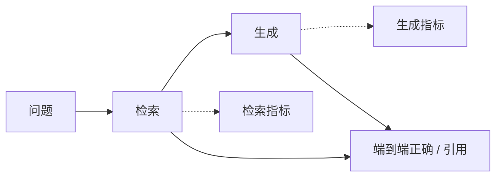

前置：[基础链路](/ai-eng/rag/01-basics/) 里的「10 题最小评估」够起步；本文补全 **怎么验** 和 **常用开源框架**。

---

## 1. 先分清：验的是哪一段

RAG 不要只看「最终答得对不对」。至少拆两段：



| 层级 | 在问什么 | 没过先修哪 |
|------|----------|------------|
| 检索 | 该找的段在不在 Top-K？噪声多不多？ | 切分 / Embedding / 混检 / Rerank |
| 生成 | 有没有编造？有没有答到点上？ | Prompt / 拒答 / 模型 |
| 端到端 | 用户视角是否可用？引用是否成立？ | 按上面两段回流 |

**口诀：先看检索，再看生成。** 检索错了，别先怪大模型。

---

## 2. 如何验证（实操顺序）

### 2.1 准备评测集

每条最少包含：

| 字段 | 说明 |
|------|------|
| `question` | 问题 |
| `golden_doc_id` / `golden_chunk_id` | 期望命中的依据（测检索） |
| `ground_truth`（可选） | 参考答案（测正确性） |
| `type` | fact / multi-hop / out_of_scope |

题型要盖住：

1. 文档里有明确答案的事实题  
2. 需要多段拼起来的题  
3. 库外题（应拒答 / 说资料不足）

没有标注时：可用框架做 **合成问答**（从文档生成 Q&A），再人工抽检一遍。

### 2.2 跑流水线，落四元组

每条样本产出：

```text
{
  question,
  contexts,      # 检索到的 Chunk 文本列表
  answer,        # 模型回答
  ground_truth   # 可选
}
```

### 2.3 看哪些指标（常用）

| 指标 | 含义 | 要不要标准答案 |
|------|------|----------------|
| Context Recall | 该有的依据有没有被召回 | 要（或 golden chunk） |
| Context Precision | 召回里相关占比高不高 | 要相关标注 / LLM 判 |
| Faithfulness / Groundedness | 回答是否忠于资料（防幻觉） | 不要标准答案 |
| Answer Relevancy | 回答是否切题 | 不要 |
| Answer Correctness | 和参考答案是否一致 | 要 |

线上还可加：点赞点踩、拒答率、引用合规率（见进阶「反馈闭环」）。

### 2.4 伪代码：最小验证环

```text
dataset = load_eval("eval.jsonl")
rows = []

for case in dataset:
    hits = retrieve(case.question)
    ans  = generate(case.question, hits)
    rows.append({
        question: case.question,
        contexts: [h.text for h in hits],
        answer: ans,
        ground_truth: case.ground_truth,
        hit: case.golden_id in [h.id for h in hits]
    })

# 人工或框架打分
print("检索命中率", mean(r.hit for r in rows))
scores = framework.evaluate(rows)   # 如 Ragas / DeepEval
print(scores)

# 对比实验：一次只改一个开关
compare(["baseline", "hybrid", "hybrid+rerank"])
```

### 2.5 验收习惯

1. **一次只改一个模块** 再对比  
2. 指标下降时回到对应层级（检索 vs 生成）  
3. LLM 自动打分要 **抽检**，别全信评委模型  
4. 把评测集纳入 CI：改检索/Prompt 后回归  

---

## 3. 常用开源评测框架

| 框架 | 定位 | 典型用途 | 许可证（常见） |
|------|------|----------|----------------|
| **[Ragas](https://github.com/explodinggradients/ragas)** | RAG 指标库 + 可合成测试集 | 离线算 Faithfulness / Context Recall 等 | Apache-2.0 |
| **[DeepEval](https://github.com/confident-ai/deepeval)** | 偏测试 / CI 的 LLM 评测 | pytest 风格回归门禁 | Apache-2.0 |
| **[TruLens](https://github.com/truera/trulens)** | 追踪 + RAG Triad 打分 | 开发期/线上可观测、Context Relevance / Groundedness / Answer Relevance | MIT |
| **LlamaIndex Eval** | 嵌在 LlamaIndex 生态 | 已用 LlamaIndex 时快速评检索与回答 | MIT |
| **LangSmith**（有免费档，偏产品） | 追踪 + 数据集 + 评测器 | 链路 tracing 与回归；不全是「纯开源库」 | 商业服务 + SDK |
| **Phoenix（Arize）** | 开源可观测与评测 | Trace、检索可视化、评测集 | Elastic-2.0 等（以仓库为准） |
| **RAGChecker** 等研究向工具 | 细粒度诊断 | 论文/深度分析检索与生成错误类型 | 看具体仓库 |

### 怎么选（实用）

| 你的目标 | 更合适 |
|----------|--------|
| 快速离线打一套 RAG 指标 | **Ragas** |
| 要进 CI：不达标就 fail | **DeepEval** |
| 要看每次请求的检索/生成过程 | **TruLens** 或 Phoenix |
| 已经深度绑 LlamaIndex | LlamaIndex 自带 Eval |
| 团队要共享数据集与实验板 | LangSmith / Phoenix |

常见组合：

```text
离线指标：Ragas
回归门禁：DeepEval
开发可观测：TruLens 或 Phoenix
```

### 3.1 Ragas（示意）

```text
# pip install ragas datasets
# 输入：question / contexts / answer / (optional) ground_truth

from ragas import evaluate
from ragas.metrics import faithfulness, context_precision, context_recall, answer_relevancy

result = evaluate(dataset, metrics=[
    faithfulness,
    context_precision,
    context_recall,
    answer_relevancy,
])
print(result)
```

### 3.2 DeepEval（示意）

```text
# 偏单元测试：断言忠实度 / 相关性达到阈值
# 适合 PR 门禁：检索或 Prompt 改动后自动跑
```

### 3.3 TruLens RAG Triad

| 三角 | 含义 |
|------|------|
| Context Relevance | 检索到的上下文和问题是否相关 |
| Groundedness | 回答是否站得住脚（有无依据） |
| Answer Relevance | 回答是否回答了问题 |

---

## 4. 和前几篇的关系

| 文档 | 评测写到哪 |
|------|------------|
| 基础链路 | 10 题手填表、命中率 / 正确率 |
| 常用增强 | 开关对比（baseline vs 混检 vs Rerank） |
| 进阶 | 分项指标、反馈进评测集 |
| **本文** | 验证步骤 + 开源框架选型 |

---

## 5. 收束

验证三步：

```text
建评测集 → 落四元组(question/contexts/answer[/gt]) → 分检索/生成打分并回流
```

框架记三个就够上手：

```text
Ragas（指标） · DeepEval（CI） · TruLens（追踪与 RAG Triad）
```
